**TO:** Coaster Lab Owner
**SUBJECT:** Coaster Lab 10.1 — engineering, security and feature upgrade: what was found, what was changed, what is left

The upgrade is built as `coaster_lab_v10_1.html`. It is the game you uploaded with its weak points closed, saves you
can rely on, a Diagnostics page for you, and new tools in the Track Builder and My Park. Nothing was removed.

**Two things need you** (section 11): the database changes are written and tested but **not applied** to the real
Supabase project, and a few Supabase settings could not be checked from here. The three branches that held work
missing from this build were merged in afterwards, at your request: see the addendum, section 12.

Words used in this report: **confirmed** means it was reproduced by a test that is in the repository, or by a query
against the real project. **Confirmed by reading** means the code plainly does it but no attack was run.
**Theoretical** means it could matter but no way to exploit it was found. Nothing here was made up to fill a list.

---

## 1. How the work was done

1. **Backup first.** The uploaded file is kept untouched as `backup/coaster_lab_preview_v2_original.html`
   (2,519,925 bytes, sha256 `5d6fcde5e736a3500924e8a2dd535c68b028159b7406316fe4419f322c144b87`).
   `coaster_lab_v10_0.html` was not changed either.
2. **Where the upload came from.** The upload is a single generated file. Its source was found in the repository:
   it is the park-upgrade line merged with the sharper-graphics branch, without one small balance change
   (`832c1c4`). Work continued from that source, so every change is a readable source change, not an edit to a
   2.5 MB generated file.
3. **Small, checked changes.** The build applies text patches that must each match exactly once, and inserts new
   modules that wrap existing functions. If a patch stops matching, the build stops.
4. **Tests before and after.** The existing suites were run on 10.0 first (all passed) to have a baseline. Each fix
   then got a test that fails on 10.0 and passes on 10.1 where that was possible.
5. **The real database was only read.** The live Supabase project was inspected read-only. No migration was applied
   and no data was changed.

## 2. Audit findings

Severity is for the game as it would be with its online features switched on. **Today they are not**: the 10.0
database set-up was never applied to the real project, so nothing can be published and there is no leaderboard to
attack. Findings marked ☁ only become reachable when that is switched on, which is exactly when they would matter.

### Security

| # | Sev. | Finding | Where | Evidence | Impact | Fix in 10.1 | Test |
|---|---|---|---|---|---|---|---|
| S1 ☁ | **High** | Leaderboard statistics from another player's browser were put into the page as HTML | `28_ty_share.js` (Share tab list), database `cl_publish_park` stored them as sent | **Confirmed**: a park published with HTML as its "rating" ran script in every player's leaderboard on 10.0 | Stored cross-site scripting: one hostile park runs code for everyone who opens the Share tab (their saves and sign-in are in reach) | Every cloud answer is rebuilt field by field (`cRow10`, `cStats10`, `cPark10`…): numbers must be numbers, codes must be codes, text is escaped. The database cleans statistics on the way in and out | `t20` A, B; SQL D3, D5, D20 |
| S2 | **Medium** | No Content-Security-Policy | page `<head>` (`build.mjs`) | **Confirmed**: injected markup with an `onerror` handler ran on 10.0 | Any future HTML slip becomes script execution | Policy added: no event-handler attributes, no plugins, frames, workers or unknown hosts | `t20` C |
| S3 | **Medium** | Names such as `constructor` and `toString` passed the "is this a known thing?" checks | `20_ty_core.js` `cleanPark10` (things, weather, styles, custom designs); 9.0 `sanDesign` | **Confirmed**: a park code using them got past the checks and threw an error on 10.0; a pasted design did the same | A hostile park code or design text breaks the game for whoever opens it. No way to run code through it was found | Own-property checks (`has10`) everywhere a catalogue is looked up | `t20` D, H |
| S4 | **Medium** | A park code could unpack without limit | `28_ty_share.js` `unpack10` | **Confirmed**: a 16 kB code unpacked to 12 MB | A small pasted code can freeze or crash the tab | Unpacking stops at 4 MB with a plain message | `t20` E |
| S5 ☁ | **Medium** | Live presence trusted what other browsers sent | `28_ty_share.js` (`LIVE10`) | **Confirmed**: 300 fake visitors were all drawn; positions of 9e15, any text as a reaction and `owner: "yes"` were accepted | Flooding, off-map pins, fake reactions, anyone showing the 👑 | At most 40 people, positions kept inside the park, six known reactions, one a second, `owner` must be exactly `true`, automatic reconnect | `t20` F |
| S6 ☁ | **Medium** | A sign-in link synced this device's parks to whatever account the link was for | `28b_ty_account.js` | **Confirmed by reading**, and the fix by test | Someone who sends you a link to *their* account receives your park when you open it | "Is this your account?" with the account's email; nothing is sent before the answer; "Not me" signs out | `t20` I |
| S7 ☁ | **Medium** | Two tabs signed each other out | `28b_ty_account.js` `token10` | **Confirmed** on 10.0. A second way was found late (see section 8): when both tabs renewed at the same moment, the tab that was refused still signed everyone out, even though it had already heard of the other tab's new session. **Confirmed** by a test that holds the server's answer back | Lost session; with unlucky timing an unsynced park | Tabs share the renewed session through storage; a refused renewal only signs out if the refused token is still the one the tab holds; sync jobs run one at a time | `t20` I |
| S10 ☁ | **Low** | "Sign out" did not always sign the device out when the game was open in two tabs | `28b_ty_account.js` `token10` and the `storage` listener | 10.0: **confirmed by reading** (it has no code that hears another tab's sign-out, so the other tab kept its session). 10.1 before the last fix: **confirmed** by test: the other tab followed, but if it was renewing its session at that moment, the late answer signed both tabs back in | On a shared computer the account stays signed in after "Sign out". It needs a second open tab; in 10.1 it also needed a renewal (once an hour, a fraction of a second) to be on its way | The other tab follows a sign-out; a renewal answer is only kept if the tab is still signed in to the account that asked | `t20` I |
| S8 | **Low** | The owner and moderator locks opened without the passcode after typing the test flag into the console | 9.0 code, `build.mjs` patch | **Confirmed** on 10.0 | Opens the owner tools. They only change that browser's own copy of the game, so the damage is local | The flag is read once when the page starts (`HARNESS10`) | `t20` G |
| S9 ☁ | **Low** | A shared park copy carried the publisher's cloud code; the game forgot its own published code on reload | `28_ty_share.js` `shareSnap10`, `20_ty_core.js` | **Confirmed** on 10.0 | Confusion about who owns a published park; duplicate publishes | Shared copies drop it; the park keeps it if it has the right shape | `t20` E |
| D1 ☁ | **High** | `cl_publish_park` stored statistics exactly as sent | 10.0 migration | **Confirmed** on a local copy: HTML came back verbatim from `cl_list_parks` | The server side of S1 | Statistics are reduced to known numeric fields; output is cleaned again | SQL D3, D5, D20 |
| D2 ☁ | **Medium** | One park with a non-numeric rating broke the rating leaderboard for everyone | `cl_list_parks('rating')` | **Confirmed**: numeric cast error | Anyone could switch the leaderboard off | Safe conversion | SQL D4 |
| D3 ☁ | **Medium** | No rate limits on publishing, rating, saving or renaming; unlimited anonymous ratings | 10.0 migration | **Confirmed by reading** | Spam, rating manipulation, free storage | Per-address and per-account limits; at most 3 anonymous ratings per address per park; visits count once per caller per park per day | SQL D7, D9, D13, D16–D19, E9, E14 |
| D4 ☁ | **Medium** | Sign-up took the player name as sent | sign-up trigger | **Confirmed**: raw name stored | Markup in names, look-alike and official-looking names, same name in different capitals | Names cleaned, reserved names refused, unique ignoring capitals | SQL C1–C3, B6–B8 |
| D5 ☁ | **Low** | Things that are not parks were accepted as parks and as saves | `cl_publish_park`, `cl_save_put` | **Confirmed**: `{"a":1}` accepted | The database as free storage | Shape and size checks | SQL D6, E5 |
| D6 | **Low** | The signed-out role held table privileges it never needs (including TRUNCATE) | Supabase default grants | **Confirmed** in the catalogue. **Theoretical** as an attack: the API does not offer TRUNCATE | Nothing today; one mistake away from mattering | Privileges removed; signed-in players may change only their own `username` | SQL A1–A8, B1–B5 |

### Reliability and bugs

| # | Sev. | Finding | Where | Evidence | Fix | Test |
|---|---|---|---|---|---|---|
| B1 | **High** | My Park crashed with "Maximum call stack size exceeded" | `47_parksim.js` (a visitor following a family leader), through `gGo10 → gDecide10 → gArrive10 → gStep10` | **Confirmed**: an ordinary starter park (two flat rides, food, drinks, restrooms) stops 10.0 within two park days. It did so in 8 runs of 8; which day depends on which visitors turn up. The old suites never built that park, which is why the 10.0 baseline passed. The same crash had already been found and fixed on the `park-build-2` branch | The fix from `park-build-2`, plus a safety net that stops any visitor after six nested decisions. In the test the safety net is never needed | `t24` J (10.0 stops, 10.1 plays three days), `t24` H, `t9` |
| B2 | **High** | A save that could not be read was silently replaced by an empty park | `loadPark10` | **Confirmed** on 10.0: a day-3 park became a new day-1 park | The unreadable save is kept, the newest backup is loaded, the player is told | `t21` B |
| B3 | **High** | With the game open in two tabs, the older tab saved over the newer park | `savePark10` | **Confirmed** on 10.0: two of three benches gone | Saves are numbered; the older tab stops and says why; a background tab catches up | `t21` C |
| B4 | **Medium** | A failing save (storage full or blocked) gave a passing notice, at most once a minute; nothing on screen showed that the park was still unsaved | `savePark10`, 8.1 `saveFail81` | **Confirmed by reading**; the fix by test | A warning stays on screen until a save works; the Office says what to do | `t21` E |
| B5 | **Low** | Importing a design with a built-in property name as section type gave an error and no message | 9.0 `sanDesign` | **Confirmed** on 10.0 | "Can't import: section 1 has an unknown type" | `t20` H |
| B6 | **Low** | On a phone the builder's dock was squeezed to a 2 px column for about a third of a second on opening | 9.0 CSS | **Confirmed** on 10.0 by sampling its position | No sideways transition on narrow screens | `t23` G |

### Looked at and found sound

Not everything needed changing. These were checked and left alone:

- **The publishable key in the page** is meant to be public. No service-role key, secret key or other credential is
  in the page or the repository.
- **The owner passcode** is not in the page: only a salted, slow fingerprint is, wrong tries are rate-limited, and
  the owner tools have no server powers.
- **Cloud saves** already refused to overwrite a newer save without asking, and other players' saves were not
  readable (the 10.1 SQL tests confirm both).
- **three.js** is loaded with an integrity hash.
- **Game money** is added and removed only through two functions with a ledger; the existing tests check the
  balance after every step. It is single-player data on the player's own device and is not treated as trustworthy
  anywhere (see section 6 on payments).

## 3. What could not be verified

- **Supabase Auth settings** (email confirmation, redirect addresses, sign-up limits, token lifetimes) could not be
  read from this environment. Check them in the dashboard against the README.
- **Leaked-password protection is off** on the project, according to Supabase's own security advisor. It is a
  dashboard switch.
- **The hardening migration has only run on a local PostgreSQL 16** with a stand-in for Supabase's roles, built from
  the live schema as it was read on 2026-11-15. The real project runs PostgreSQL 17. Apply it to a Supabase branch
  or a copy first.
- **Rate limits depend on the network address the API gateway reports.** The functions read the headers Supabase
  sets; this could only be simulated locally.
- **No physical phone was used.** Every screen-size result is from a headless desktop browser set to that size, with
  software graphics. Touch behaviour, Safari's own quirks and real frame rates were not tested.

## 4. Security risks that remain

| Risk | Why it remains | What would remove it |
|---|---|---|
| The database fixes are not live | Applying a migration to your real project is your decision | Apply both migrations, in order, after trying them on a branch |
| The 👑 in live presence is self-declared | Presence messages go browser to browser; `owner` now has to be exactly `true`, but a modified page can still send that | Have the server sign who owns a park, or drop the crown |
| Leaderboard ratings and statistics are reported by the player's own game | The simulation runs in the browser | Recalculate on the server, or label leaderboards as "self-reported" |
| The owner lock is a lock on the page | Someone who edits their copy of the page can open the owner tools, which change only their own copy | Nothing needed while owner tools have no server powers. Any future moderation of published parks must be a server role, never this lock |
| Inline scripts are still allowed by the policy | The game is one file with one large inline script | Serve the script as a separate file with a hash or nonce |
| The policy is a `<meta>` tag | A single file cannot send response headers, so `frame-ancestors` (who may embed the game) cannot be set | Set the header where the file is hosted |
| A session's access token works until it runs out, even after "Sign out" | That is how the account service works: signing out ends the session and its renewals, and the game forgets the token, but a token that was copied earlier stays valid until it expires (an hour unless changed) | A shorter token lifetime in the Auth settings, or database functions that check the session still exists (Supabase documents both) |
| The trailer's video comes from an outside host (added by the merge, section 12) | The trailer branch streams it from a CDN address on a player's first visit. That host sees the visitor's network address, and whoever controls that address decides what plays. The policy lets that host serve pictures and video only, never script. If the video is ever removed, the trailer closes by itself and the game starts as usual | Host the video next to the game |
| Two tabs saving in the very same instant | Browser storage has no lock; the save counter narrows the window to milliseconds but cannot close it | The Web Locks API, where the browser has it |
| Park codes and backup files from strangers | They are cleaned field by field on the way in; a new field added carelessly later could bypass that | Keep the rule: every new saved field gets a line in `cleanPark10` |
| Local saves can be edited by their owner | They are on the owner's device | Nothing: it is their own single-player game. It is why game money must never be sold |

## 5. New features

**Developer Diagnostics Center** (Owner Control Center → 🩺 Diagnostics): frames a second, average and 95th-percentile
frame time and a frame chart; draw calls, triangles, shaders; geometry and texture counts with an estimate of their
memory; graphics quality, pixel ratio, drawing size, WebGL version; cloud, account and save status; storage use;
recent warnings and errors (repeats counted, anything that looks like a token cut short); health warnings with
thresholds; My Park simulation numbers; a report to copy or download that never contains tokens or the device key;
an on-screen frame counter. It exists only behind the owner lock.

**Track Builder**: live numbers with the change a piece would make; a status chip; "Good next pieces"; History with
named Undo and Redo; Test from here; ten more ready-made layouts; closest ready-made layouts in the Sketch Studio;
scrolling rows that show where there is more. The sketch feature is the "closest blueprint" option from the brief:
it compares the shape you drew with every ready-made layout and offers the nearest. It does not read a photograph or
a paper drawing.

**My Park**: Reports, Park Advisor, Recent events, moods by visitor type, short lines, mechanic priority, an optional
service policy, visitor remarks, honest leave reasons, CSV download. The economy's rules were not changed: no
price, cost, wage or reward is different. The additions report on the simulation. Three act on it: short lines and
the service policy, which are off until the player switches them on, and the order in which mechanics choose
between broken rides, which is always on.

**Saves**: status, a warning that stays, three daily backups, recovery of unreadable saves, two-tab protection,
checksummed backup files. A newer save is never overwritten by an older one without the player choosing to.

## 6. Payment readiness (design only)

No payment was switched on, no card form exists, and nothing in the page unlocks anything. `docs/payments/` holds
the design, a database proposal that passes 47 local tests, and two reference server functions that have never been
run. The main conclusion is in its section 2: because the whole game is on the player's device, **only things the
server gives out can really be sold** (more cloud save slots, more published parks, a server-issued supporter
mark). Park money must not be sold, and a page-only unlock is an honour system and should be described as one.

## 7. Interface polish

- Reports, backups and diagnostics fit a 320 px wide phone; wide tables fold their extra columns under the name.
- Keyboard focus is visible on the new builder and park controls; text links in the report tables are tall enough to tap.
- The builder's numbers move to their own row on an upright phone instead of crowding the top bar.
- New animation respects "reduce motion".
- Messages say what happened and what to do, in plain words ("That backup is damaged: it does not match its own
  checksum (part of the file may be missing)").

## 8. Tests performed and results

**How the tests run.** Every browser test drives the real game file in headless Chromium (through Playwright) with
software graphics, at one or two frames a second. The four screen sizes (320×568, 390×844, 844×390, 1200×800) are
browser window sizes; `tests/README.md` says which suite uses which. The park cloud and the account server are
played by a stand-in (`tests/tools/cloud_mock.js`). The real Supabase project was never written to. **No physical
phone or tablet was used, and no browser other than Chromium.**

**Before any change.** The 17 suites that already existed were run on `coaster_lab_v10_0.html`: 653 checks passed,
0 failed.

**10.1: three full runs of all 22 suites.**

| Run | Build (sha256) | Passed | Failed | What failed |
|---|---|---:|---:|---|
| 1 | first complete 10.1 | 865 | 2 | The new Reports tab was wider than a 320 px and a 390 px screen (`t8`, one check at each size). Fixed: on phones the wide columns fold under the name. `t24` I now checks this more strictly |
| 2 | `5fb782af…` | 866 | 1 | "Signing out in one tab signs the other tab out too" (`t20`), which had passed in run 1 |
| 3 | `79d65bac…` (the build delivered) | 875 | 0 | Nothing |

Between runs 2 and 3 one more run was started and stopped after seven minutes: another browser test had been started
next to it, and one suite (`t2b_disaster`) ran out of time waiting for an animation. That was a mistake in how the
tests were run, not a finding. Run 3 is the complete run made afterwards with nothing else running.

**What the one failure in run 2 led to.** The check waited a fixed half second for the other tab to hear of the
sign-out; with software graphics that tab can be busy for longer. That was a fault in the test, which now waits for
the event. Reading the code to rule out a fault in the game found two real ones in the same place (S7's second way
and S10 in section 2). Both were reproduced on demand by holding the account server's answer back, fixed in one
function (`token10`), and added as checks. The two new checks were also run against the build from before the fix:
both fail there.

Three things were added to the suites while finishing, so the last run has more checks than the first two:

- **The crash (B1) now has a before-and-after test** (`t24` J). The economy tool, run on 10.0 to compare the books,
  stopped with the crash every time. A starter park was then tried five more times on 10.0: it stopped within two
  park days each time.
- **Going back to 10.0** (`t21` G): a park saved by 10.1 opens in 10.0 with the same day, money and things; 10.0
  drops only the week's books, the staff policy and the short line; back in 10.1 it opens without an error.
- The "Is this your account?" question is checked at all four screen sizes (`t20` I).

**The final run, suite by suite** (build `79d65bac760c065d1ee48727b5215ceb981d8975793faa927fdffe852dd11d2b`):

| Suite | Covers | Passed | Failed | Time |
|---|---|---:|---:|---:|
| `t0_baseline` | No console errors at both sizes; measures every ride (it prints measurements, not PASS lines) | ran clean | 0 | 0:32 |
| `t1_gravity` | Gravity Lab | 32 | 0 | 2:25 |
| `t2a_same` | Disaster Mode off: rides identical to 8.5 | 1 | 0 | 0:17 |
| `t2b_disaster` | Disaster Mode | 30 | 0 | 2:28 |
| `t3_evolve` | Evolve | 36 | 0 | 3:32 |
| `t4_daily` | Daily Challenge | 31 | 0 | 2:26 |
| `t5_regress` | Older features next to 8.5 | 27 | 0 | 5:43 |
| `t6_v90` | 9.0 builder levels, repair, blueprints, sketches, four sizes | 82 | 0 | 6:50 |
| `t7_v10_rides` | The 10.0 coasters and trains, Generate | 35 | 0 | 6:08 |
| `t8_v10_park` | My Park: building, ledger, visitors, cloud, four sizes | 135 | 0 | 7:33 |
| `t9_sound` | Sound | 29 | 0 | 2:53 |
| `t10_v10_gfx` | Graphics extras and quality ladder | 26 | 0 | 1:38 |
| `t11_v10_account` | Accounts and cloud saves, four sizes | 82 | 0 | 10:11 |
| `t13_terra` | Hills and lakes | 25 | 0 | 1:00 |
| `t14_fx` | Park effects, fireworks | 25 | 0 | 0:59 |
| `t15_parksim` | Upkeep, themes, photos, families, scenarios | 29 | 0 | 1:28 |
| `t16_builder` | Roomier builder, force colours | 28 | 0 | 1:13 |
| `t20_security` | **New.** Every hardening item attacked, with 10.0 for comparison; two tabs sharing a sign-in | 34 | 0 | 9:07 |
| `t21_saves` | **New.** Backups, damaged saves, two tabs, backup files, going back to 10.0, four sizes | 36 | 0 | 7:00 |
| `t22_diag` | **New.** Diagnostics, four sizes | 33 | 0 | 2:21 |
| `t23_builder6` | **New.** Track Builder additions, four sizes | 46 | 0 | 3:53 |
| `t24_parkpro` | **New.** Reports, Advisor, queues, staff, the 10.0 crash, four sizes | 73 | 0 | 10:10 |
| **Total** | 22 suites | **875** | **0** | 90 min |

**Database tests** (`bash supabase/tests/run.sh`, on a local PostgreSQL 16 with a stand-in for Supabase's roles):
64 passed, 0 failed. That is 63 checks of the 10.0 and 10.1 migrations (privileges, player names, publishing,
ratings and visits, saves, rate limits, deleting an account) and "every migration can be run a second time". With
the purchases proposal (`bash supabase/tests/run.sh payments`): 112 passed, 0 failed, which adds its 47 checks and
"the proposed schema can be run a second time".

**Other checks that were run**

- `node build.mjs --check`: every text patch matched exactly once and the built page's script parses.
- The economy tool (`tests/tools/balance.js`) on 10.1: a sensible starter park lost $6,158 on its building day and
  then made $608, $648 and $297 a day; after growing it made $1,144 and $929 a day; a neglected park fell to
  reputation 20.6. No errors. **The same run on 10.0 could not be finished**: it stopped with the crash (B1) in
  three attempts out of three. The one first day 10.0 completed had books close to 10.1's (income $2,419 against
  $2,348, 48 visitors against 46, rating 56 against 57). The statement that no price, cost, wage or reward changed
  rests on reading the changed lines of the simulation, not on a seven-day comparison.

**What was not tested**

- Real phones and tablets, touch, Safari and Firefox.
- The real Supabase project with the migrations applied, the real account server and its emails.
- The two payment reference functions (never run), and anything involving a payment provider.
- `t4_corners` (an optional 15-minute proof that every Daily Challenge theme can be passed) was not run; nothing it
  covers was changed.

**Screenshots.** The suites save pictures as they go. These are from the final run (headless Chromium, software
graphics), copied to `docs/report-10.1/`:

| | |
|---|---|
| 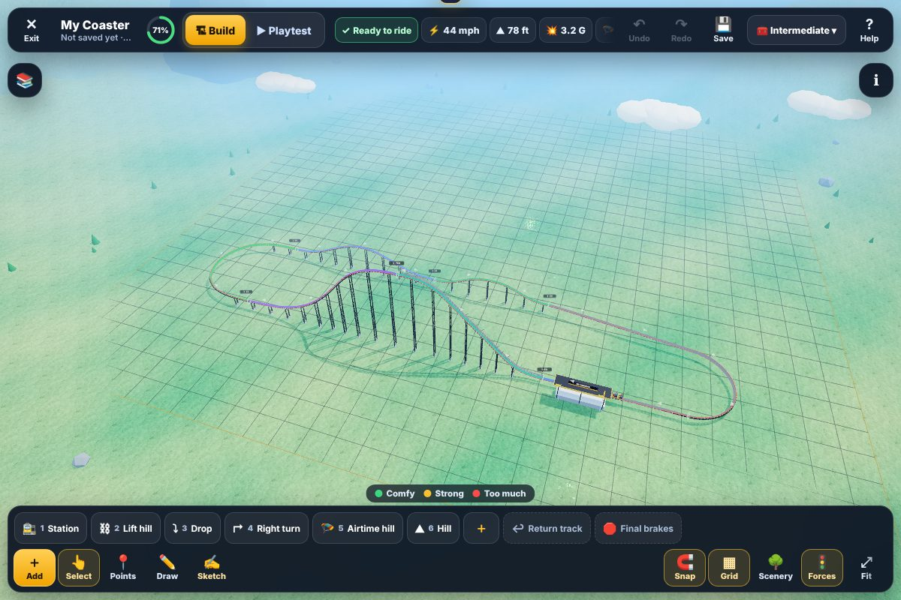 Track Builder: live numbers in the top bar, force colours on the track | 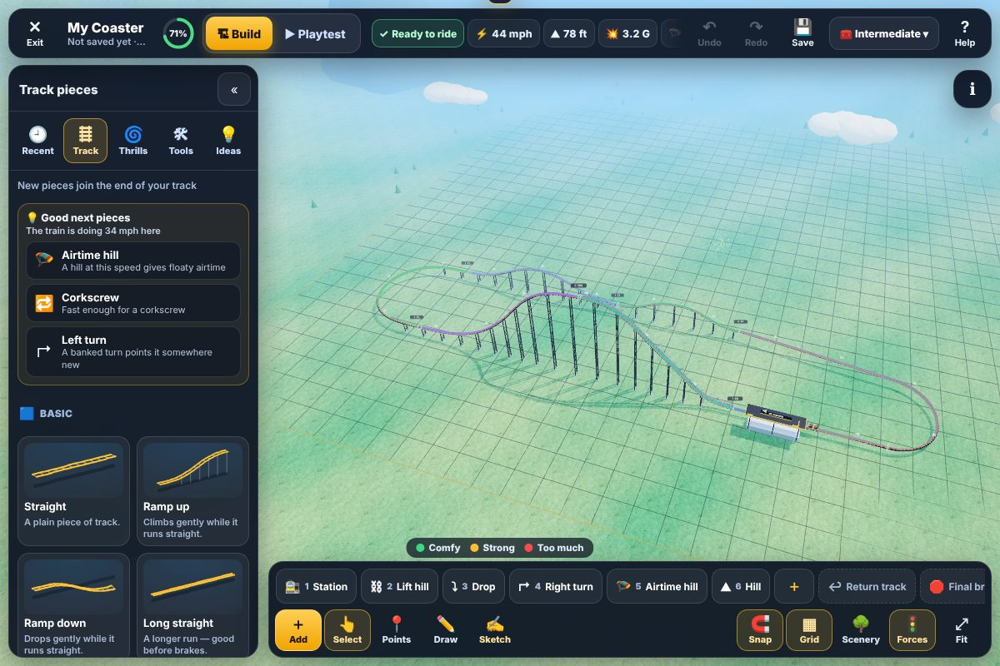 "Good next pieces" for the speed the train has there |
| 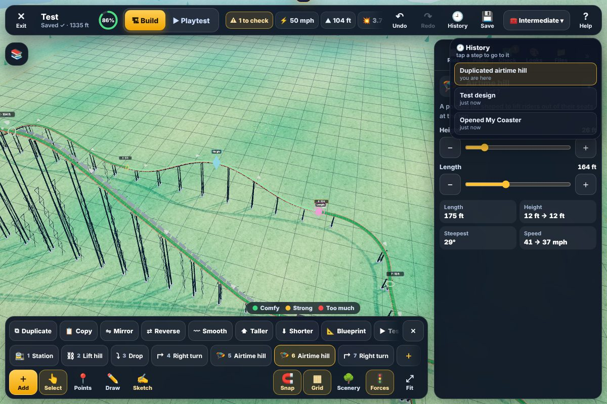 History: tap a step to go back to it | 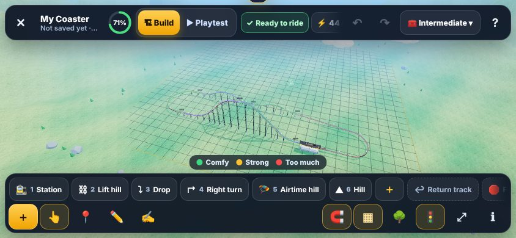 The builder at 844×390 |
| 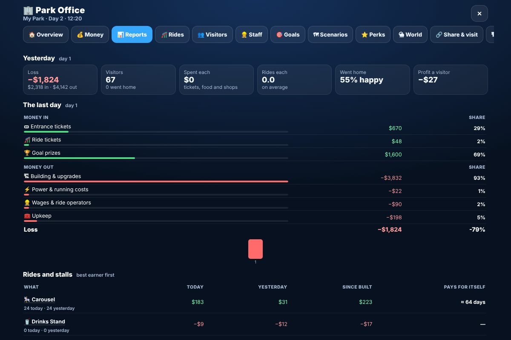 Park Office → Reports: yesterday's books, each ride's earnings | 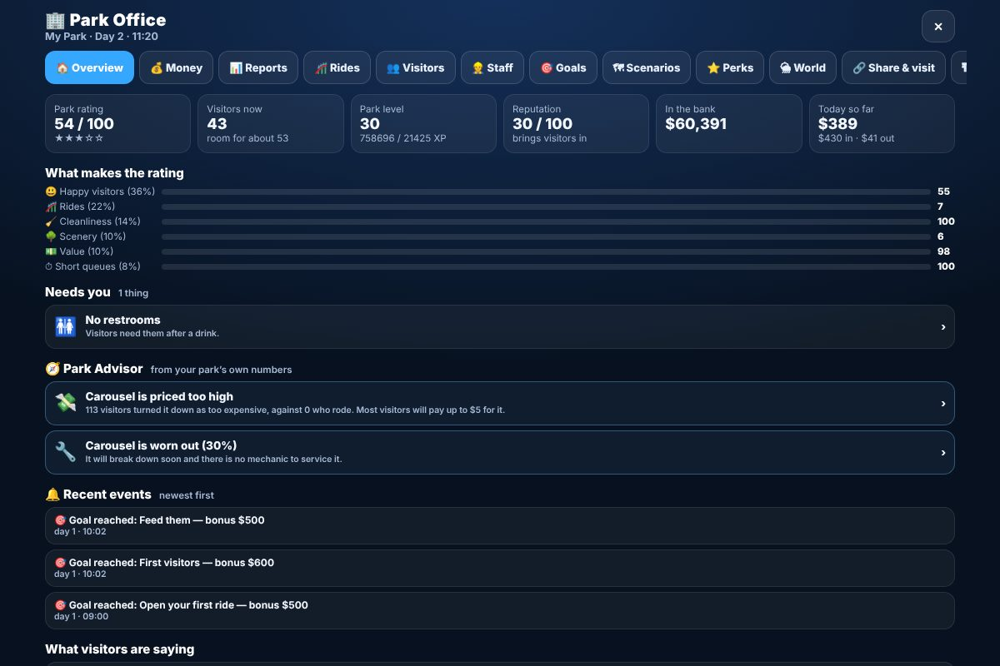 Overview: what makes the rating, and the Advisor's notes |
| 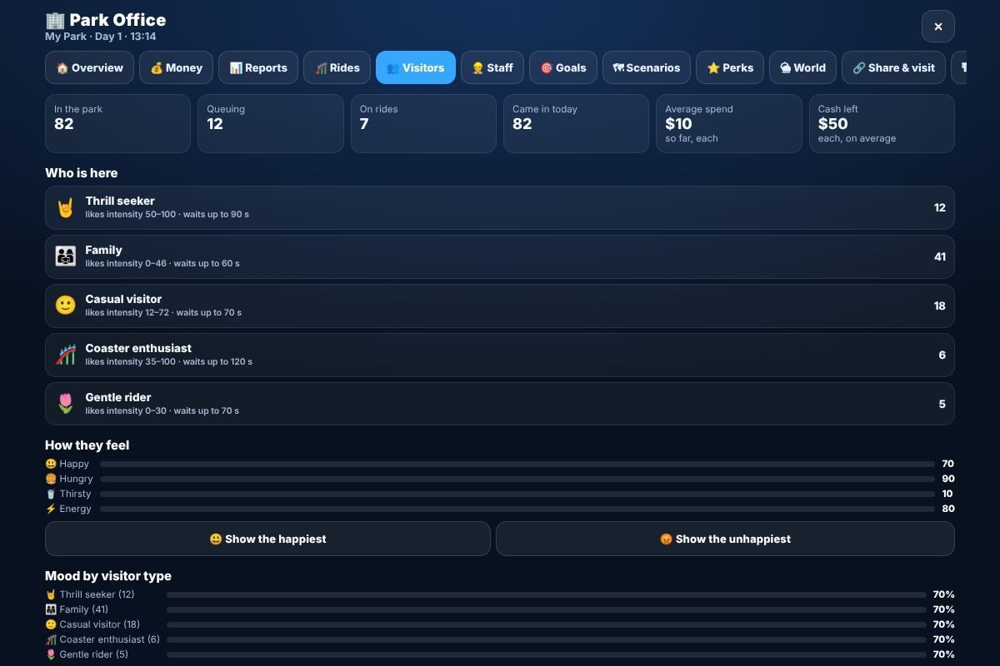 Visitors: who is in the park and how they feel | 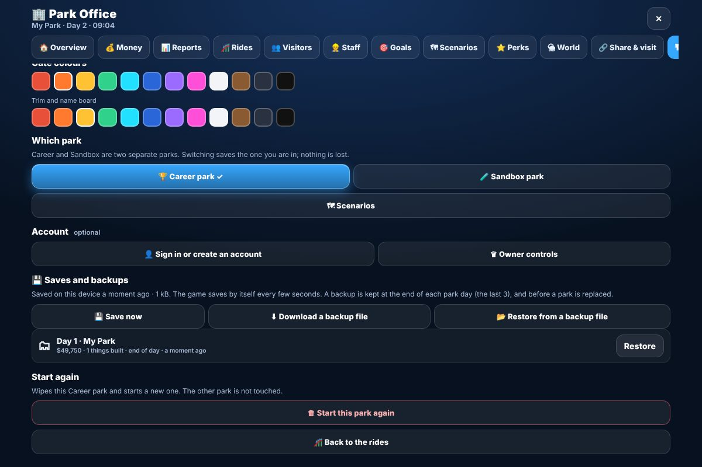 Saves and backups: save now, backup file, restore |
| 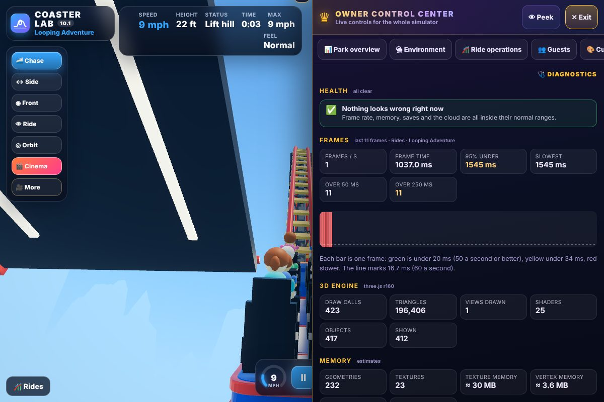 Owner Control Center → Diagnostics (the frame times are the test machine's software graphics) | 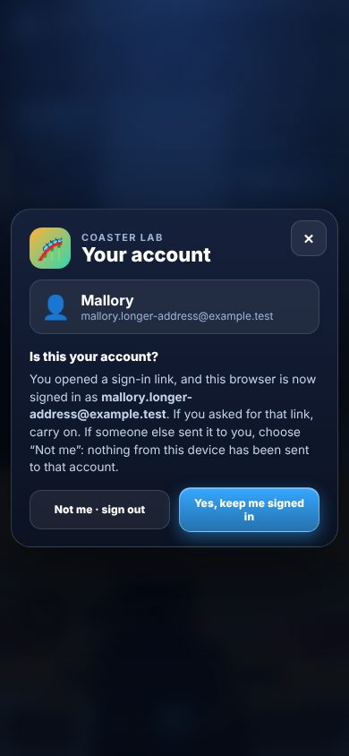 The question a sign-in link now asks first (390×844) |
| 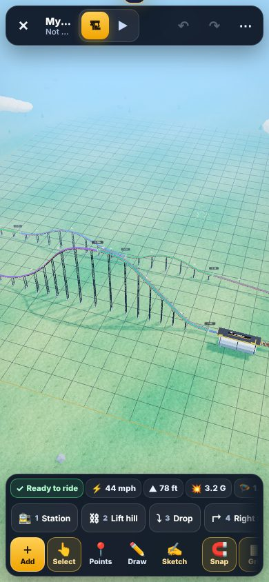 The builder at 390×844 | 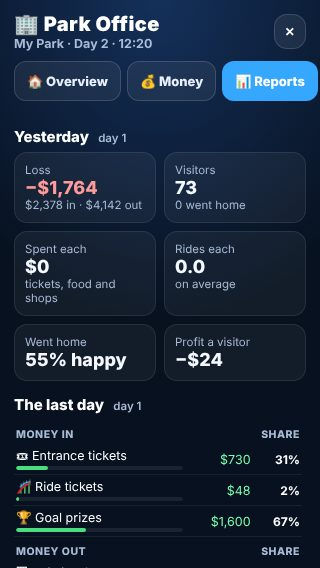 Reports at 320×568 |
| 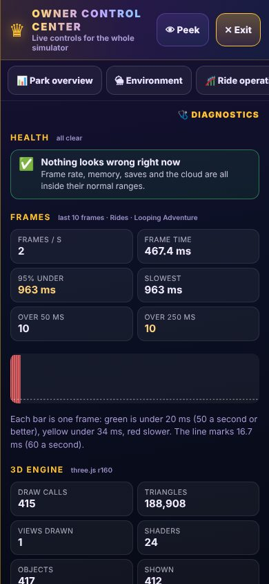 Diagnostics at 390×844 | 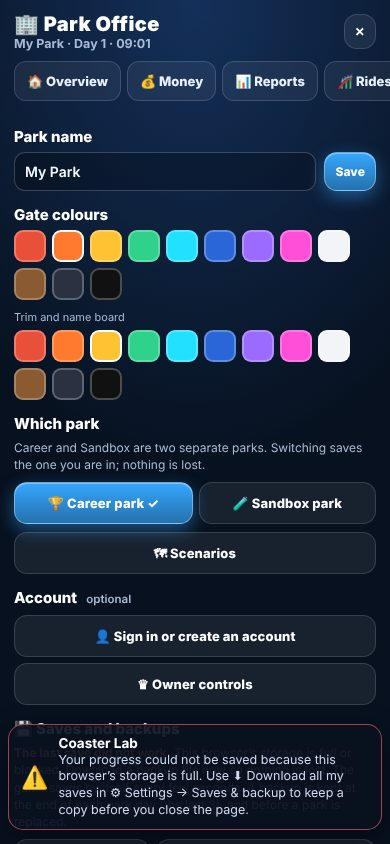 The warning that stays while saving fails |

## 9. Known issues and limits

- **The online features are still off** in the real project: neither database migration has been applied.
- **No real phone was used.** Sizes were tested in a desktop browser set to phone dimensions. Frame rates in the
  tests are from software graphics and say nothing about a real device.
- **The crash test (B1) depends on chance in 10.0.** Which visitors turn up decides the day 10.0 stops on. It stopped
  within two park days in 8 runs of 8, and the test allows a second try, but a 10.0 run that survives three days is
  possible. The 10.1 half of the test does not depend on chance.
- **The two-tab sign-in tests use a stand-in for the account server** that refuses a used renewal token at once.
  The real service, by default, accepts a used token again for 10 seconds (Supabase's documentation), so those
  moments should be rarer there. They could not be tried against the real service.
- **Staff "busy" figures, repair times and Recent events live in memory.** They restart when the page is reloaded.
  The week's books, queue settings and the service policy are saved with the park.
- **A park from before 10.1** has no day counters, so each ride's "today" starts counting when the park is first
  opened in 10.1.
- **A child or partner leaving with a family** is filed under the family leader's reason for going home.
- **The Advisor is a set of about twenty rules** over the park's numbers, showing at most five suggestions. It does
  not predict; it points at what the numbers already show.
- **Sketch matching compares the plan (the shape seen from above) only**, not heights or which pieces are used.
  "65% alike" is a similarity score. It does not read photos or paper drawings.
- **Thunder Comet and Nova Giant are not builder blueprints**: at about 270 m across they do not fit the builder's
  190 m area.
- **Diagnostics memory figures are estimates** worked out from sizes; the browser does not report graphics memory.
- **Backups use storage, and a skipped backup is not announced.** Each of the three backups is about the size of the
  park. When there is no room, the oldest backup is dropped to make space; if there is still no room that day's
  backup is skipped. The save itself is not affected, and Diagnostics warns when storage is nearly full, but the
  player is not told that a backup was skipped.
- **Two tabs saving in the same instant** can still collide (section 4).
- **The full test run takes about an hour and a half** and a few steps depend on timing in a headless browser. Run
  the suites one at a time with nothing else using the machine: a second browser test started next to a run made
  one suite time out here (section 8). A failure should be re-run on its own and explained before it is dismissed:
  the one failure in run 2 looked like timing and led to two real defects.
- **10.1 includes one balance change the uploaded preview did not have** (`832c1c4`, already on the repository's main
  line): visitors who can afford nothing, or leave without a single ride, go home unhappy.

## 10. Recommended next phase

1. **Bring the branches together.** **Done** (section 12): `coaster-lab-daily-streak`, `park-build-2` and `trailer` are
   merged. Other branches exist in the repository and were not looked at.
2. **Switch the cloud on properly.** Apply both migrations to a Supabase branch, run `supabase/tests`, then apply
   them to the real project. Switch on leaked-password protection, check the Auth settings, then try publishing, a
   leaderboard and a cloud save against the real project (the automated suites use a stand-in).
3. **Test on real phones**, starting with an iPhone in Safari: touch, the notch and home-bar areas, and frame rates.
   The Diagnostics report was built for collecting exactly those numbers.
4. **One writer at a time for saves** with the Web Locks API where the browser has it, closing the last two-tab gap.
5. **Leaderboards the server can stand behind**: recalculate ratings on the server from the published park, or label
   them as reported by the player's own game.
6. **Host the game with response headers**: the Content-Security-Policy as a header (with `frame-ancestors`), and the
   script as a separate file so inline script can be switched off.
7. **Run the tests automatically** on every push.
8. **If anything is ever to be sold**: work through the checklist in `docs/payments/README.md`, starting with who the
   players are.

## 11. What needs you

| What | Why it is yours | Where |
|---|---|---|
| Apply the two database migrations (branch first) | Changing the real project is your decision; nothing was applied | `supabase/migrations/`, README "Cloud & accounts" |
| Switch on leaked-password protection; check Auth settings | Dashboard only; could not be read from here | Supabase dashboard → Authentication |
| Decide whether to open a pull request for this work | None was opened | Branch `claude/coaster-lab-engineering-upgrade-mbxjoc` |
| Try 10.1 on your own phone | No real device was available | `coaster_lab_v10_1.html` |

## 12. Addendum: the three branches merged

After this report was finished you asked for the three branches named in section 10 to be merged. They were merged
into this branch one at a time, each as its own merge commit, and each branch's own tests were run on the merged
build before the next one was started.

| Branch | What it brings |
|---|---|
| `park-build-2` | My Park: move anything you built, undo, entertainers, Swan Boats, four new stalls (Pizza Slice, Cotton Candy, Balloon Stand, ATM) and the Weekly Park Awards |
| `trailer` | A trailer that plays on the first visit, and a "Watch the trailer" button on the title screen |
| `daily-streak` | Daily streak and rewards: a 7-day ladder, a streak freeze, the Inferno train skin, a claim popup and a chip on the HUD (see `CHANGES-STREAK.md`) |

**What had to be reconciled.** Git reported conflicts in three files: the test list, one passage of the simulation
that both sides had changed in the same way, and the rebuilt 10.0 file. The rest it could not have known about:

- **The crash safety net existed twice.** 10.1 had already taken the crash fix from `park-build-2`, including the net
  that stops a visitor after six decisions in a row. Merged as they were, the two copies shared one counter, so
  every decision would have counted twice and the net would have tripped after three. One copy is kept
  (`60_parkpro.js`).
- **The 10.1 content security policy would have blocked the trailer.** The trailer streams its video and poster
  from a CDN address. `build.mjs` now reads that host from the trailer's own source and allows it for pictures and
  video only. `t25` checks that the host appears under no other heading.
- **`coaster_lab_v10_0.html` was left as it was.** The branches had rebuilt that file with their features in it. The
  10.1 tests use it as "10.0" for their before-and-after checks, so it stays the plain 10.0. The merged features are
  built into `coaster_lab_v10_1.html` only.
- **The branches' tests opened `coaster_lab_v10_0.html`.** They now open the 10.1 build.
- **Already there:** the sharper-graphics work that `daily-streak` carried was in 10.1 before the merge.

The new code was read against the rules of section 2: saved fields are cleaned on the way in (entertainers, the
week's tallies and the trophy cabinet each have their lines), and text is escaped before it goes into the page.
Nothing needed fixing there.

**One new test dependency:** `jsdom`, used only by `t19_streak_dom`. It is not part of the game.

**What the merge changes in the earlier sections**

- **Section 5** says no price, cost, wage or reward was changed. That is true of the 10.1 work. `park-build-2` brings
  things of its own that touch the park's money: four stalls, Swan Boats, entertainers with a wage, and cash prizes
  with the Weekly Park Awards (up to $500 a trophy). Their balance was not re-tuned or measured here.
- **Section 4** has a new row: the trailer's video comes from an outside host.
- **The daily streak** pays coins and XP by the device's own clock and is stored on the device only. Like park money,
  its owner can edit it, so it must never be sold (section 6).
- **Going back to 10.0** (`t25`): a 10.1 park that uses the merged things opens in 10.0 without an error. 10.0 does
  not have the merged stalls (the test uses Cotton Candy), so it drops them; when it saves, the entertainers and the
  trophy cabinet are gone too. Back in 10.1 the park opens as 10.0 left it. Going back is safe, but it is not lossless.
- **Section 8** describes the build before the merge (`79d65bac…`). The build delivered now is the merged one.

**Tests on the merged build** (`cd9ccd2643bb5dbd179449174f7fed9838f016fa0bad56838dc9e1314753fd34`). All 22 suites of section 8 were run again, with
the six suites the branches brought and one new suite, `t25_merged`. It covers what the branches' own tests leave
out: their park controls at 320×568, 390×844 and 844×390 (their own suites run at 1200×800), the trip to 10.0 and
back, and the trailer host in the policy.

| Suite | Covers | Passed | Failed | Time |
|---|---|---:|---:|---:|
| `t0_baseline` | No console errors at both sizes; measures every ride (prints measurements, not PASS lines) | ran clean | 0 | 0:38 |
| `t1_gravity` | Gravity Lab | 32 | 0 | 3:05 |
| `t2a_same` | Disaster Mode off: rides identical to 8.5 | 1 | 0 | 0:20 |
| `t2b_disaster` | Disaster Mode | 30 | 0 | 2:57 |
| `t3_evolve` | Evolve | 36 | 0 | 4:09 |
| `t4_daily` | Daily Challenge | 31 | 0 | 2:45 |
| `t5_regress` | Older features next to 8.5 | 27 | 0 | 6:10 |
| `t6_v90` | 9.0 builder levels, repair, blueprints, sketches | 82 | 0 | 9:55 |
| `t7_v10_rides` | The 10.0 coasters and trains, Generate | 35 | 0 | 8:09 |
| `t8_v10_park` | My Park: building, ledger, visitors, cloud | 135 | 0 | 6:50 |
| `t9_sound` | Sound | 29 | 0 | 3:58 |
| `t10_v10_gfx` | Graphics extras and quality ladder | 26 | 0 | 2:03 |
| `t11_v10_account` | Accounts and cloud saves | 82 | 0 | 10:38 |
| `t13_terra` | Hills and lakes | 25 | 0 | 1:17 |
| `t14_fx` | Park effects, fireworks | 25 | 0 | 1:10 |
| `t15_parksim` | Upkeep, themes, photos, families, scenarios | 29 | 0 | 1:20 |
| `t16_builder` | Roomier builder, force colours | 28 | 0 | 1:28 |
| `t17_parkbuild` | **Merged.** Move, undo, Swan Boats, new stalls, entertainers, Weekly Park Awards | 43 | 0 | 2:52 |
| `t17_trailer` | **Merged.** The first-visit trailer | 15 | 0 | 2:30 |
| `t18_coaster_walk` | **Merged.** Crowds walking to coasters: no crash | 10 | 0 | 2:27 |
| `t19_streak_logic` | **Merged.** Daily streak rules (plain node) | 28 | 0 | 0:00 |
| `t19_streak_dom` | **Merged.** Streak popup, chip and card (jsdom) | 37 | 0 | 0:26 |
| `t19_streak` | **Merged.** Daily streak in the real game, four sizes | 22 | 0 | 1:39 |
| `t20_security` | Every hardening item attacked; two tabs sharing a sign-in | 34 | 0 | 8:19 |
| `t21_saves` | Backups, damaged saves, two tabs, going back to 10.0 | 36 | 0 | 8:06 |
| `t22_diag` | Diagnostics | 33 | 0 | 2:42 |
| `t23_builder6` | Track Builder additions | 46 | 0 | 4:39 |
| `t24_parkpro` | Reports, Advisor, queues, staff, the 10.0 crash | 73 | 0 | 11:17 |
| `t25_merged` | **New.** The merged park controls at phone sizes; a park with merged things in 10.0 and back; the trailer host in the policy | 17 | 0 | 2:08 |
| **Total** | 29 suites | **1047** | **0** | 114 min |

**How this table came about.** It is not one unbroken run, and the first pass was not clean. The machine restarted
three times while the suites ran, and was slower afterwards (several suites took 20 to 45% longer than in section
8). Results were kept suite by suite. On the first pass 24 of the 29 suites passed and five did not. Each of the
five was looked into and run again on its own; the table shows those later runs for `t2b`, `t5`, `t20`, `t21` and
`t24`.

- `t5` stopped: the merged streak chip sits in the middle of the Home button, so the test's click on the middle of
  that button opened the streak popup. The logo and the name still go Home. The test now clicks the logo side. This
  is how the streak branch designed it; moving the chip is a decision for you.
- `t2b` ran out of time waiting for the Incident Report. The same step took about 24 s on the build from before the
  merge on this machine, against a 30 s limit. The wait is now 90 s.
- `t20` failed one two-tab check on the first pass and a different check on the second. The second was a fault in
  the test: a park whose weather name is refused starts sunny, and the weather may then change by itself before the
  test looks. The test now asks for a real weather name. The first did not happen again.
- `t21` (three two-tab checks) and `t24` (one check of visitor remarks) passed when run again with no change. They
  depend on timing, and the cause of the first failures was not pinned down beyond that.

Not run again: the database tests (no database file changed) and the economy tool. As before: headless Chromium
only, no physical phone, and the real Supabase project was not touched. The trailer tests swap the real video for a
small test clip, so the real video on its real host was not played here.
